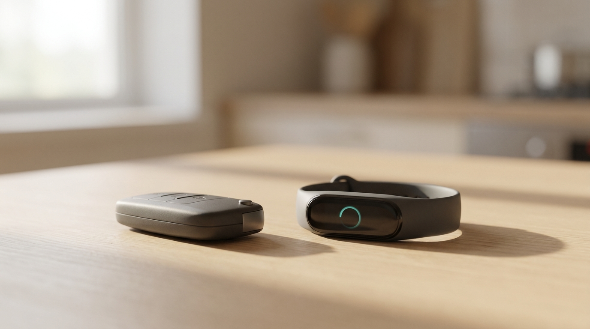
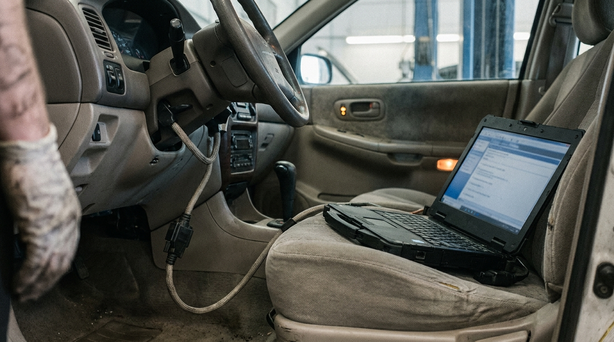
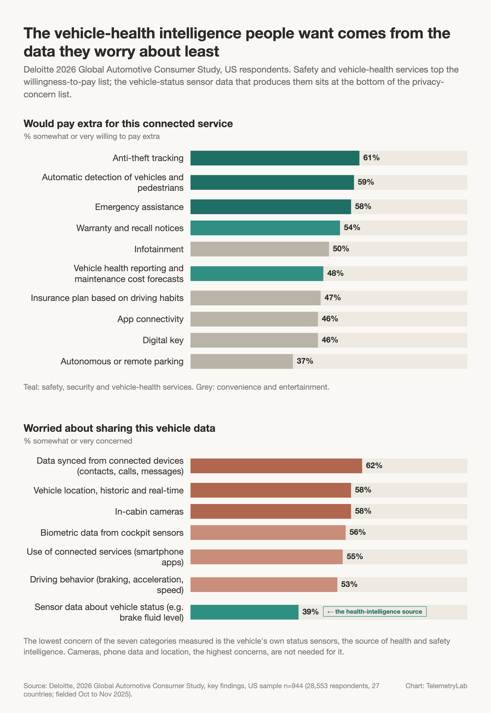
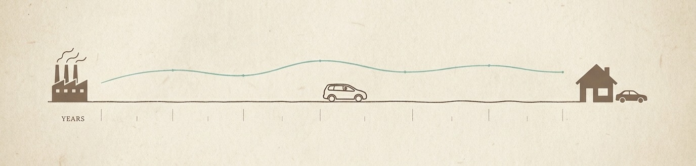

# The Fitness Tracker Your Car Never Got

*A whole industry got built on charging people monthly to interpret a heartbeat their body already produced. Your car has far more readable signal than your wrist does, nearly half of American drivers surveyed say they would pay to have it read back, and almost nobody has built the strap.*

By Sam Jafari

---

*One of these tells its owner how it is doing every morning. The other has far more to say.*

The strap on my wrist cost a few hundred dollars, and then it started charging me every month. The hardware was the cheap part. The monthly fee is for the interpretation: how I slept, whether I am recovered, whether today is a day to push or a day to back off, when I should be in bed. The heartbeat it reads was there for free my whole life, and nobody had ever read it back to me in a way that changed what I did the next morning. That is the entire business. A signal that already existed, an interpretation people did not have, and a monthly fee for the difference. Millions of people pay it and think of it simply as knowing.

Now look at the car in the driveway. The body produces far more signal than any car ever will, but almost all of it is hard to get at: a heartbeat, blood pressure, blood oxygen, glucose are the handful that cheap sensors can reach, and the rest takes a lab or a scanner. The car is the opposite. Almost everything it does is already a number on a wire. A modern car computes the state of its own brakes, battery, cooling, steering and driver-assist over and over as it drives, and passes those values around its internal network so its own modules can do their jobs. None of that is produced for anyone to read; it is just the car operating. But if you can read it, you have a running picture of the machine, and what the owner gets from all of it today is a warning light, a mileage-based service reminder, and a folder of receipts in the glovebox. The strap tells me every morning how I am doing. The car, which I actually depend on to get my family across a state line, tells me nothing until something has already gone wrong, and then it tells me with a light.

## Why nobody built it

I have spent about twenty years in data, and an uncomfortable share of the analytics I watched get built in that time was overhead: a manager had already made the decision, and a team existed to produce the charts that made it look data-driven. Nobody outside the building ever saw the output, and I say that as someone who has run data teams. The one time I saw it go the other way was at Lucid, where I built the vehicle data platform from the company's early days through to the full set of data and AI products, and it got load-bearing enough that a two-hour outage meant mechanical engineers, safety people, service, everyone downstream, stopped working, because the thing they used to know what the cars were actually doing had gone dark. What I took from that was simple. Analytics stops being overhead the moment the person who benefits from it can see it and act on it. Inside a carmaker that person is an engineer. Outside it, the person who would benefit most from the car's own data has rarely been offered it, and the industry mostly never built the strap for the owner because it rarely thought of the owner as the customer for it.

*A standard service scan gives the codes, a snapshot from when a fault tripped, and live values while the cable is in. Little of the car's history on the road survives to be read.*

You can see the gap most clearly at the service center. When the car finally comes in, what the technician gets is whatever the diagnostic port will hand over: the stored trouble codes, a frozen snapshot from the moment a fault tripped, and whatever live values the tool can poll while it is plugged in. The standardized diagnostic vocabulary runs to a couple of hundred parameters, and any one car answers to a few dozen of them, while the car's own network is carrying somewhere between ten and twenty thousand signals as it drives. The port is a keyhole, and almost none of the history comes through it. So the car goes in, gets a part, comes home, and sometimes two days later it is broken again, and neither the owner nor the technician had much chance of seeing that the failure had been building for weeks. Owners feel this even when they cannot name it. It is why a long family drive starts with a small anxious calculation about whether the car will make it, and why a car that has "been in the shop twice" loses its owner's trust in a way no service discount repairs. Don't read this as a complaint about technicians. They are working with the slice the port gives them. The strap on my wrist would be useless too if it only spoke when I was already in the emergency room.

## What people said they would pay for

Late in 2025 Deloitte asked 28,553 people in 27 countries what they would pay extra for in a connected car, and the list reads like a fitness tracker's feature page transposed onto a vehicle. I expected the answer to be entertainment. It was safety and health. Among the 944 US respondents, 59% said they would pay for automatic detection of vehicles and pedestrians, 54% would pay for warranty and recall notices, which I read as paying to be told earlier that something on their car needs attention, and nearly half, 48%, would pay for vehicle health reporting with maintenance cost forecasts. Infotainment, the thing the industry spent a decade selling as the connected feature, landed in the middle of the table. S&P Global Mobility's connected-car survey arrives at the same place from actual behavior rather than stated intent: safety and security are the services people most commonly subscribe to, and they carried some of the highest prices respondents said they would pay. The things people pay for are the things that tell them they are safe and sound, on the wrist and, it turns out, in the car.

*Deloitte 2026 Global Automotive Consumer Study, US respondents. Top: willingness to pay extra, by service. Bottom: privacy concern, by data type. Set side by side, the two findings say the vehicle-health intelligence people want comes from the data they worry about least.*

## The trust problem is easier for cars

The wearable industry had to solve a hard trust problem first. It had to convince people to hand over heart rate, sleep, location, and cycle data, some of the most intimate data a person has, to a company that would keep it forever, and to pay for the privilege. It did. Cars start from an easier place, on this evidence at least, and this is the finding I keep coming back to. Deloitte also asked which vehicle data people worry about sharing. Data synced from the phone topped the US list at 62%, then location and in-cabin cameras. At the very bottom, at 39%, sat sensor data about the vehicle's own status: brake fluid level, battery temperature, tire pressure, the health of the machine itself. Four in ten is not nothing, but it is the bottom of the list. The data that worries people most is not the data that vehicle-health intelligence needs. You can tell someone the state of their car, and forecast what it will cost them next year, from the least-feared category the study measured, without a camera pointed at their face and without their contact list.

## Engagement is the product

There is a second thing the wearable companies understood: the app is where the relationship lives. You look at it in the morning, you look at it after a run, you show a friend the sleep score. Deloitte's own read of its data is that over-the-air updates open the door for makers to strengthen brand loyalty "through frequent digital engagement," and roughly seven in ten US respondents said they would keep the vehicle two or more years longer if it kept receiving them. Anyone who has watched a Tesla owner open the app under a restaurant table has seen the mechanism at work. A car you can look at when you are not in it, and understand a little, is, I think, a car you keep longer and are more likely to buy again from the same maker. In a US market where 53% of buyers say they will switch brands next time and product quality is the number one reason they choose one, at 58%, an owner who can see that their car is doing fine is retention nobody had to advertise for.

*The loyalty math. Half the market is up for grabs at the next purchase, quality decides it, and a car that keeps engaging its owner gets kept longer.*

## The maker's side of the same strap

The intelligence the owner would pay for is largely the same intelligence most manufacturers still do not turn into a continuous view of their own fleet. A thread I came across recently on a car owners' forum opened with "I love my car" and then described a driver-attention warning that fired three or four times in a row on flat, straight highway, woke his wife in the passenger seat, and could not be found anywhere in the settings to turn off. He had worked out for himself how the feature decided he was drowsy, and he was one of well over a hundred people in the comments comparing notes, several of whom did not know their own car had the feature. Nothing in that thread will ever show up as a warranty claim, because nothing is broken. J.D. Power's 2025 tech-experience study found the same shift: vehicle quality problems have moved from broken parts to the usability of technology. That class of problem is invisible in the repair record, and it shows up mainly in how people actually use, ignore, misunderstand, and switch off features. Today it reaches the manufacturer as a forum thread, by accident, years late, with no easy way of knowing whether it is one owner or fifty thousand. The loyal owner ends up ignoring the warning, or finding a way to switch it off, and either way the engineered benefit goes to zero and the people who built it never find out.

It is not small money either. McKinsey put industry warranty-related costs at roughly $58 billion in 2024, nearly double what they were a little over a decade ago, and at some automakers warranty now rivals what they spend on R&D. Manufacturers deploying AI-driven quality systems to catch risks earlier told McKinsey they expect to cut that bill by 5 to 10 percent. Earlier in 2026 we rebuilt the public US recall record from 2022 onward and checked each campaign against the signals a connected car already produces; on our reading, about 30% of the vehicles under recall were already producing a signal that could catch the defect, with no new hardware needed to read it. Same signal, two ledgers: a health report an owner would pay for, and a warranty and recall bill an automaker would pay to shrink.

*The maker's side of the same signal. Warranty now rivals R&D at some automakers, and a meaningful share of what ends in a recall was already visible in the car's own signals.*

## Who builds the strap

By the strap I mean the whole thing, the read and the interpretation together, not the band. The maker that builds it stands to get two things at once: a paid feature consumers have already said they want, and a live read on its own fleet, which features get used, which get switched off, which failures are building, and whether a software update did what it was supposed to, before any of it shows up as a claim. The maker that does not build it leaves the owner's view of the car to whoever plugs a dongle into the port. Either way somebody builds the strap. Don't mistake this for a call for another app with a battery-percentage tile. The wearable's value sits underneath the display, in the model that turns a heart rate into "you are recovered," and that layer is the part almost no owner has ever been handed. Much of it needs no new sensor; the status data is already on the vehicle.

*The car tells the story of its whole life as it drives. Almost none of it is kept, and almost none is read back to the people it belongs to.*

Every morning the strap on my wrist tells me how I am doing, from a heartbeat nobody had ever interpreted for me. The car in the driveway has far more to say and says almost none of it. The signal is there. Somebody has to build the strap.

---

*This is the gap we work in at TelemetryLab, the intelligence layer for connected vehicles and robotic fleets: it turns the operational telemetry these systems already produce into diagnostic, prognostic and operational intelligence, in an environment the customer owns and controls. If any of this matches what you are seeing in your own fleet, I would like to hear it.*

---

## Sources

- Deloitte, 2026 Global Automotive Consumer Study, 14th edition. 28,553 respondents in 27 countries, fielded October to November 2025. Willingness to pay for connected services, data-sharing concern by data type, brand-switching intent and brand-choice drivers, ownership extension with over-the-air updates.
- S&P Global Mobility, Connected Car Consumer Survey, 2025 edition. Safety and security as the most commonly subscribed connected services, at among the highest willingness to pay.
- McKinsey & Company, "When warranty costs rival R&D spend: Remaking vehicle quality with AI," 2025. Industry warranty-related costs of roughly $58 billion in 2024, nearly double 2012, above 4% of revenue at some OEMs; expected 5 to 10 percent reduction from earlier, AI-enabled detection.
- J.D. Power, 2025 U.S. Tech Experience Index (TXI) Study. Quality problems shifting from broken components to the usability of technology.
- TelemetryLab Research, "The Recall Signal Gap," 2026. The public NHTSA recall record from 2022 onward checked against signals a connected vehicle already produces.
- The owners' forum thread is public and is described without naming the brand or the vehicle; the point is the pattern, not the product. Percentages are quoted as published; the Deloitte, S&P and J.D. Power surveys refresh annually, so the figures are a dated snapshot.
